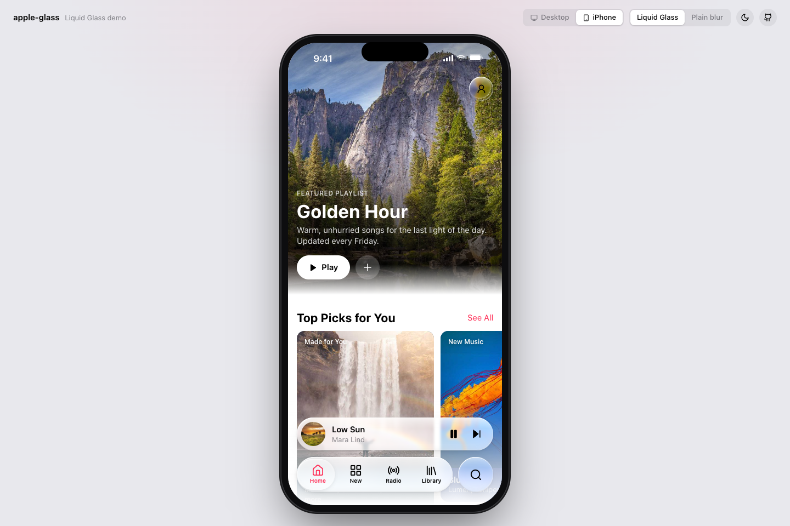
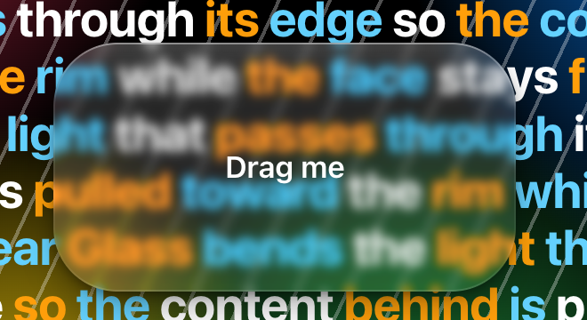
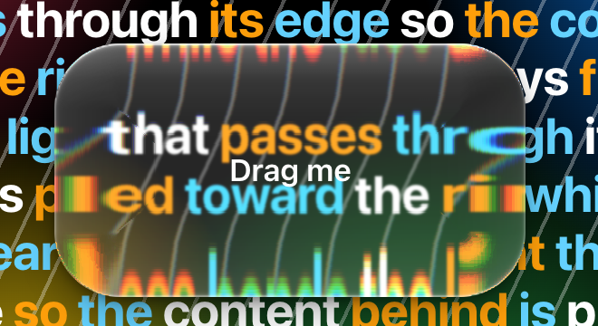

# apple-glass

**Make a web app look, move and feel like Apple's own apps on iOS 26 and macOS Tahoe.**

A Claude skill. It does real Liquid Glass, not a blurred box with a border: the edge of each pane bends the content behind it toward the rim, magnifies it there, and catches the light. It also covers Apple's exact dark palette, San Francisco text styles, 44 pt targets, capsule and concentric shapes, and app-like micro-interactions. A working kit and a page-by-page workflow come with it.

**[Try the live demo →](https://subh05sus.github.io/apple-glass-skill/demo/)** A music app built with the kit, on a Mac window or an iPhone. Switch between Liquid Glass and a plain blur, and between dark and light. The lens needs Chrome or Edge.



| Plain blur (what most "glass" is) | Liquid Glass (this skill) |
|---|---|
|  |  |

---

## What you can ask

Once it's installed, talk to Claude Code about your app:

> make the tab bar and toolbar **liquid glass** like iOS 26

> give this dashboard a **native-feeling dark mode**

> add **micro-interactions**: press springs, a lens that slides between tabs, rolling numbers

> do a **spacing and polish pass** over the settings pages

> **rethink** the onboarding so it feels like an Apple app

The skill decides where glass belongs (only on controls that float above the content, never on cards or lists). It asks you for choices in rounds, builds with the kit, and checks the result in screenshots.

---

## Install

In Claude Code, as a plugin:

```
/plugin marketplace add subh05sus/apple-glass-skill
/plugin install apple-glass@apple-glass
```

Or from a copy of this repo:

```bash
git clone https://github.com/subh05sus/apple-glass-skill ~/apple-glass-skill
ln -s ~/apple-glass-skill/skills/apple-glass ~/.claude/skills/apple-glass
```

---

## The Liquid Glass lens

Apple's [Materials guidelines](https://developer.apple.com/design/human-interface-guidelines/materials) describe Liquid Glass as a functional layer that floats above content. What makes it look like glass is the rim:

- **Lensing.** The pane is a thick slab with a rounded edge. Light through the edge bends inward, so the content behind curves and magnifies toward the rim. The face stays flat and clear.
- **Specular rim.** The curved edge catches the light as a thin bright line, brighter on the lit side.
- **Dispersion.** Colour fringes faintly where the bend is strongest.

`skills/apple-glass/assets/kit/liquid-lens.js` builds this as optics:

1. Models the edge as a convex squircle, `h(x) = (1 − (1 − x)^4)^(1/4)`.
2. Refracts a straight-down ray through it with Snell's law (n = 1.5).
3. Limits the magnification at the rim so content never folds into streaks or mirror images.
4. Draws a displacement map and a specular map for each element's exact size and corner radius.
5. Applies both as an SVG filter inside `backdrop-filter`.

It needs no framework:

```html
<link rel="stylesheet" href="liquid-glass.css">
<nav class="liquid-glass" id="bar">…</nav>
<script type="module">
  import { attachLiquidGlass } from "./liquid-lens.js";
  attachLiquidGlass(document.getElementById("bar"));            // regular glass
  // attachLiquidGlass(el, { variant: "clear", radius: 36 });     // over photos and video
</script>
```

In React, use `GlassSurface` and `GlassButton` from `glass.tsx`.

**Browser support:** only Chromium (Chrome, Edge, Arc, Brave) applies an SVG filter inside `backdrop-filter`. Safari, every iOS browser and Firefox get the frosted material plus a bevel rim, designed to look intentional on its own. Reduce Transparency, Increase Contrast and a Solid surface style are all handled.

---

## What's inside

```
skills/apple-glass/
  SKILL.md                 the rules and the workflow Claude follows
  references/              materials, dark palette, type and layout, components,
                           micro-interactions, the rethink workflow
  assets/kit/              working code: liquid-lens.js, liquid-glass.css, glass.tsx,
                           tab bar, segmented control, glass slider, sheets, switches,
                           swipe rows, animated numbers, page transitions, motion tokens
  scripts/shoot.mjs        screenshots and a design audit of a running app
demo/                      the live demo (a music app: index.html, app.css, app.js)
```

The React kit expects React 19, Next.js, Tailwind CSS v4, `motion` and shadcn/Radix. `assets/kit/README.md` lists what each file needs. The kit comes from SparkMentor, where it runs in production.

## License

MIT
